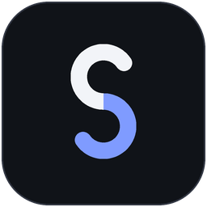
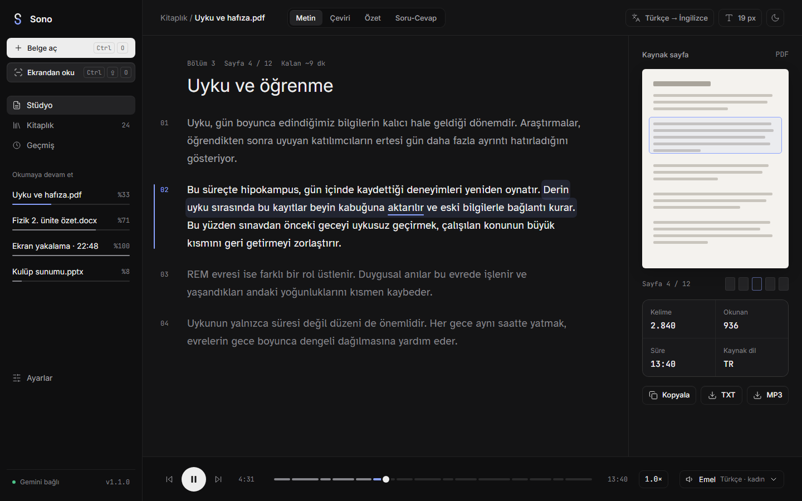
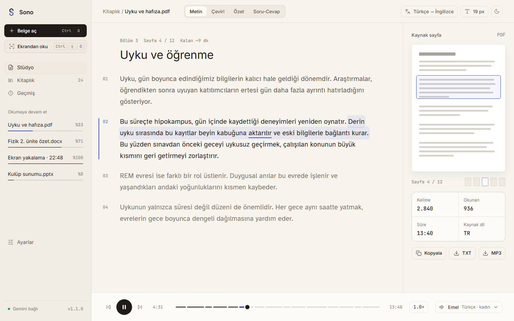

<p align="center">
  
</p>

<h1 align="center">Sono</h1>

<p align="center">
  <strong>Windows için yapay zeka destekli belge okuma (OCR), çeviri, özetleme ve sesli okuma (TTS) masaüstü uygulaması.</strong>
</p>

<p align="center">
  
  
  
  
</p>

---

<p align="center">
  
</p>

**Sono**, görsellerdeki, ekran görüntülerindeki ve ofis belgelerindeki (PDF, DOCX, PPTX, TXT) metinleri **Google Gemini API** ile okuyup çevirmenizi, özetlemenizi, belgeye soru sormanızı ve **Microsoft Edge-TTS** ile kelime takibi eşliğinde dinlemenizi sağlar.

## Ekran Görüntüleri

<table>
  <tr>
    <td width="50%" align="center">
      <br />
      <sub><strong>Koyu · Grafit Stüdyo</strong> — Çerçevesiz okuma sayfası, paragraf segmentli oynatıcı</sub>
    </td>
    <td width="50%" align="center">
      <br />
      <sub><strong>Açık · Kağıt Stüdyo</strong> — Gündüz okuma netliği, cümle bandı ve kelime vurgusu</sub>
    </td>
  </tr>
</table>

## v1.1 Yenilikleri

- **Yeni Stüdyo Arayüzü:** Koyu Grafit / Açık Kağıt temaları, 256 px kenar çubuğu, üst çubuk sekmeleri ve çerçevesiz kitap sayfası okuma alanı.
- **Sistem (Windows) Teması & Kalıcılık:** Windows temasını otomatik izleyen Sistem seçeneği ve kalıcı tema kaydı.
- **Paragraf Segmentli Oynatıcı:** Tıklanabilir paragraf parçaları, kelime bazlı ilerleme ve hız seçici (`0.5x – 2.0x`).
- **Otomatik Çeviri, Özet ve Anlamlı Çeviri:** Sekmeye geçince otomatik çeviri/özet hazırlama ve bağlamı koruyan gelişmiş çeviri istemi.
- **Görsel/Taranmış PDF Desteği:** Metin katmanı olmayan PDF'ler otomatik olarak Gemini OCR ile okunur.
- **Akıllı Otomatik Kaydırma & Sayfa Geçişi:** Uzun metinlerde otomatik kaydırma ve çok sayfalı belgelerde kaynak sayfa takibi.
- **Temiz Veri Depolama & Kurulum:** `.exe` modunda veriler `%APPDATA%\Sono` klasöründe saklanır; `SonoSetup-1.1.exe` kurulum sihirbazı eklendi.

## Özellikler

- **Belge ve Görsel Yükleme:** PNG, JPG, JPEG, WEBP, BMP görselleri ile PDF, DOCX, PPTX ve TXT belgelerini sürükle-bırak, dosya seçici veya panodan yapıştırma (`Ctrl+V`) ile yükleme; çok sayfalı belgelerde sayfa/slayt gezintisi.
- **Görsel Düzenleme:** Saat yönünde 90° döndürme ve fareyle alan kırpma penceresi.
- **Ekran Bölgesi Yakalama ve Anında Okuma:** Global kısayol (`Ctrl+Shift+O`) ile ekranı karartıp seçtiğiniz alanı anında Gemini OCR'dan geçirip sesli okuma.
- **Yapay Zeka Araçları (Gemini API):**
  - 9 dile çeviri (Türkçe, İngilizce, Almanca, Fransızca, İspanyolca, İtalyanca, Rusça, Arapça, Japonca), yerel dil algılama ve **⇄ Yan yana** orijinal/çeviri görünümü.
  - 3–5 maddelik özet çıkarma, OCR/imla düzeltme ve belgeye soru sorma (Soru-Cevap).
  - 429/503 hız limiti veya sunucu yoğunluğunda otomatik bekleme ve yeniden deneme.
- **Doğal Sesli Okuma (Edge-TTS) ve Oynatıcı:**
  - Türkçe (Emel, Ahmet) ve yabancı dillerde doğal sesler; hız (`0.5x – 2.0x`), ses seviyesi ve tek tıkla sessize alma.
  - Kelime bazlı vurgulama (okunan / aktif / kalan metin) ve okuma sırasında metinde herhangi bir kelimeye tıklayarak o noktadan devam etme.
  - Seçili metinden veya imleç konumundan okuma, paragraf atlama, ileri/geri sarılabilir zaman çubuğu, sonraki paragraf ön-hazırlığı (prefetch) ve uyku zamanlayıcısı.
- **Toplu İşleme ve Dışa Aktarma:**
  - Birden fazla dosya/görseli sırayla okuma veya tek bir `.mp3` dosyasında birleştirme.
  - Metin ve çevirileri `.txt`, `.docx`, `.pdf`, `.md` ve `.mp3` olarak kaydetme.
- **Kitaplık ve Kaldığı Yerden Devam:** Taranan belgeler yerel `history.db` (SQLite) veritabanında saklanır, arama yapılabilir ve kaldığınız paragraftan devam edebilirsiniz.
- **Pano İzleme ve Sistem Tepsisi:** İsteğe bağlı pano izleme bildirimi ("Okuyayım mı?"), sistem tepsisine küçültme ve Windows ile başlatma seçeneği.
- **Güncelleme Denetimi:** Ayarlar → Güncellemeler sekmesinden herkese açık GitHub Releases üzerinden yeni sürüm denetimi ve tek tıkla güncelleme.

---

## Kurulum (Son Kullanıcılar — `.exe`)

Python kurulumu gerekmez:

1. **[Releases](https://github.com/mert2091/Sono/releases)** sayfasından en güncel `Sono.exe` dosyasını indirin ve istediğiniz bir klasöre koyun (ör. `C:\Uygulamalar\Sono\Sono.exe`).
2. `Sono.exe` dosyasına çift tıklayarak başlatın.
3. Uygulama ilk çalıştığında gerekli kişisel dosyaları (`.env`, `settings.json`, `history.db`, `logs/sono.log`) otomatik olarak `%APPDATA%\Sono` klasöründe oluşturur; ayrıca tek tıkla kurulum için `SonoSetup-1.1.exe` de sunulmaktadır.

> **Not:** Uygulama imzasız açık kaynak bir `.exe` olduğu için Windows SmartScreen ilk açılışta *"Windows bilgisayarınızı korudu"* uyarısı gösterebilir. **Ek bilgi → Yine de çalıştır** seçeneğiyle devam edebilirsiniz.

---

## Gemini API Anahtarı Alma ve Girme

Sono'nun OCR, çeviri, özet ve soru-cevap özellikleri için ücretsiz bir Google Gemini API anahtarı gerekir:

1. [Google AI Studio — API Keys](https://aistudio.google.com/app/apikey) sayfasına gidin ve Google hesabınızla ücretsiz bir API anahtarı oluşturun.
2. Sono'yu açın. Henüz anahtar girilmemişse uygulama sizi doğrudan **Ayarlar → Yapay zeka** ekranına yönlendirir.
3. Anahtarınızı maskeli giriş kutusuna yapıştırıp **Doğrula ve kaydet** düğmesine tıklayın.
4. Sono anahtarı hafif bir test isteğiyle doğrular, yalnızca bilgisayarınızdaki `.env` dosyasına kaydeder ve uygulamayı yeniden başlatmanıza gerek kalmadan hemen etkinleştirir.

Alternatif olarak `Sono.exe` (veya proje kökü) yanına `.env.example` dosyasını `.env` adıyla kopyalayıp `GEMINI_API_KEY=` satırının karşısına anahtarınızı yazabilirsiniz.

---

## Varsayılan Klavye Kısayolları

Tüm kısayollar **Ayarlar → Kısayollar ve özellikler** ekranından özelleştirilebilir veya kapatılabilir:

| Kısayol | İşlev |
| --- | --- |
| `Ctrl+Shift+O` | Ekran bölgesini yakala, oku ve seslendir (global) |
| `Boşluk (Space)` | Sesli okumayı duraklat / devam et |
| `←` / `→` | Önceki / sonraki paragrafa atla |
| `Ctrl+Enter` | Aktif sekmedeki metni sesli oku |
| `Ctrl+V` | Panodaki ekran görüntüsünü yapıştır |
| *(İsteğe bağlı)* | Uygulamayı göster / gizle (Ayarlar'dan atanabilir) |

---

## Sık Sorulan Sorular (SSS)

**İnternet bağlantısı olmadan çalışır mı?**
Hayır. OCR, çeviri, AI araçları (Google Gemini API) ve sesli okuma (Microsoft Edge-TTS) aktif internet bağlantısı gerektirir. Yerel Kitaplık ve belge açma çevrimdışı çalışır.

**API anahtarım ve belgelerim nereye kaydediliyor?**
API anahtarınız yalnızca `%APPDATA%\Sono\.env` dosyasına, ayarlarınız `settings.json`'a ve Kitaplık geçmişiniz `history.db`'ye kaydedilir (geliştirme modunda proje kökünde tutulur). Anahtar hiçbir zaman `logs/sono.log` dosyasına, hata mesajlarına veya `.exe` içine yazılmaz.

**Bir hata alırsam ayrıntıları nerede görebilirim?**
Teknik hata ayrıntıları uygulama klasöründeki `logs/sono.log` dosyasına kaydedilir. **Ayarlar → Yapay zeka → Hata kaydını aç** düğmesiyle doğrudan açabilirsiniz.

**Güncellemeler nasıl çalışır?**
**Ayarlar → Güncellemeler** ekranına herkese açık GitHub depo adresini girdiğinizde Sono yeni sürümleri GitHub Releases API üzerinden anahtarsız olarak denetler ve indirip kurabilir.

---

## Geliştirici Kurulumu

### Gereksinimler
- Windows 10/11
- Python 3.10 veya üzeri

### Kaynak Koddan Çalıştırma
```powershell
git clone https://github.com/mert2091/Sono.git
cd Sono
python -m venv venv
.\venv\Scripts\Activate.ps1
pip install -r requirements.txt
copy .env.example .env
python main.py
```

### Tek Dosya `Sono.exe` Derleme
```powershell
pip install pyinstaller
python build_exe.py
```
Derleme tamamlandığında tek parça çalıştırılabilir dosya `dist\Sono.exe` konumunda oluşturulur.

### Proje Yapısı
```text
├── main.py                  # Uygulama başlangıç noktası ve HiDPI ayarı
├── config.py                # .env okuma/yazma ve çalışma zamanı anahtar yönetimi
├── version.py               # Tek kaynak sürüm bilgisi (APP_NAME, APP_VERSION)
├── build_exe.py             # PyInstaller --onefile Sono.exe derleyicisi
├── assets/                  # Uygulama logosu (PNG, ICO) ve arayüz ikonları
├── ui/                      # CustomTkinter arayüz bileşenleri
├── services/                # Gemini OCR/AI, Edge-TTS, belge ayrıştırma ve güncelleyici
├── utils/                   # Yol çözümleme, metin ve görsel yardımcıları
└── scripts/                 # Yardımcı başlatma ve teşhis betikleri
```

---

## Hata Bildirimi ve İletişim

Bir hata ile karşılaşırsanız veya yeni bir özellik önermek isterseniz:

- **GitHub Issues:** [Yeni bildirim oluştur](https://github.com/mert2091/Sono/issues)
- **E-posta:** [mertyedekhesap02@gmail.com](mailto:mertyedekhesap02@gmail.com)

---

## Lisans

Bu proje [MIT Lisansı](LICENSE) altında sunulmaktadır.
